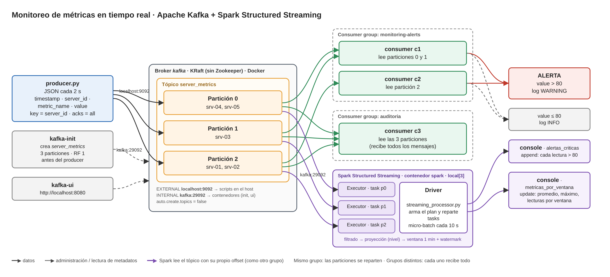
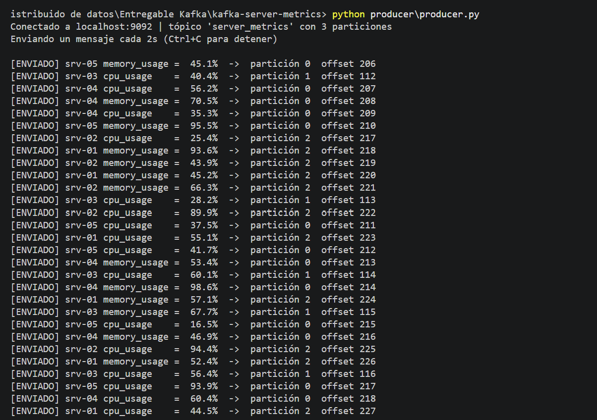
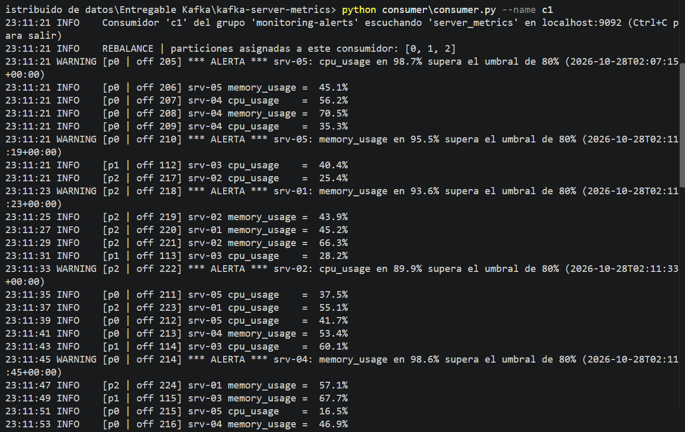
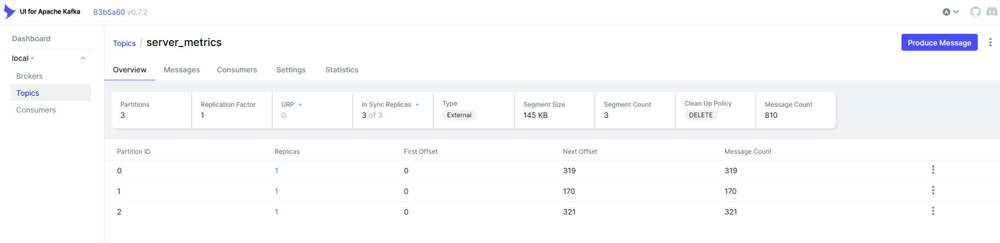
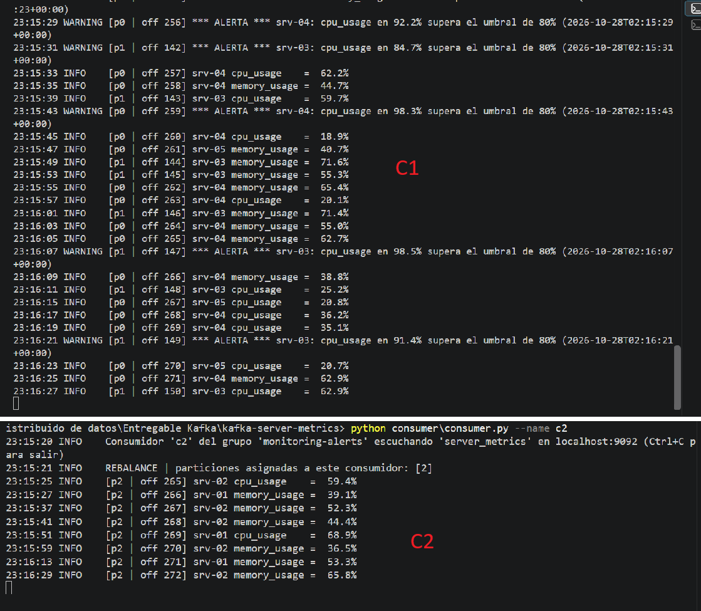
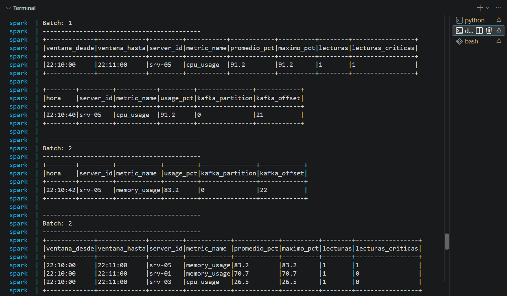
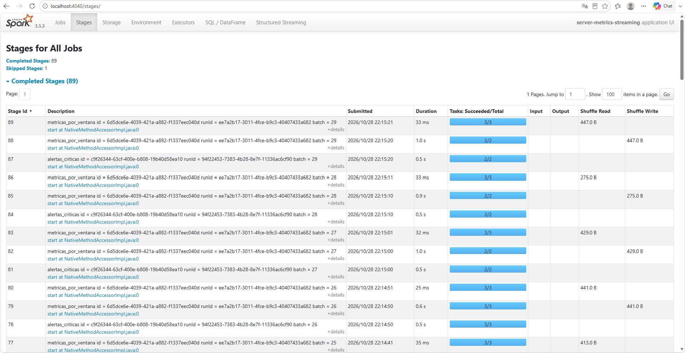

# Monitoreo de métricas de infraestructura en tiempo real con Apache Kafka y Spark

Pipeline de streaming que simula el monitoreo de servidores:

- **Kafka (unidad 3):** un **producer** en Python publica métricas sintéticas de CPU y memoria en el tópico `server_metrics`, de **3 particiones**, en un clúster Kafka local con Docker. Un **consumer**, parte de un consumer group, las procesa en tiempo real y emite una **alerta** cuando un valor supera el 80 %.
- **Spark (unidad 4):** un job de **Spark Structured Streaming** (`spark/streaming_processor.py`) consume el mismo tópico y, con DataFrames, filtra registros inválidos, calcula el nivel de cada lectura y agrega promedios, máximos y conteos por servidor en **ventanas de 1 minuto**. Ver [Procesamiento distribuido con Spark](#procesamiento-distribuido-con-apache-spark).

## Arquitectura



**Flujo:**

1. `docker compose up` levanta el broker en modo **KRaft**. El servicio `kafka-init` espera a que esté sano y crea `server_metrics` con 3 particiones **antes** de que exista cualquier producer.
2. El **producer** publica un JSON cada 2 segundos con `server_id` como **key**. Kafka asigna la partición a partir de esa key, así que todas las métricas de un mismo servidor quedan en la misma partición y en orden.
3. Los **consumers** del grupo `monitoring-alerts` se reparten las particiones. Cada partición la lee un solo consumidor del grupo.
4. Un consumer de **otro grupo** (`auditoria`) recibe todos los mensajes, con su propio offset, sin afectar al primer grupo.
5. Si `value > 80`, el consumer emite un log de nivel `WARNING` con la alerta.
6. **Spark Structured Streaming** lee el mismo tópico (con su propio offset, como un grupo más) desde la red de Docker, procesa cada micro-batch en 3 tasks paralelas, una por partición, y publica alertas y agregados por ventana en consola.

## Estructura

```
.
├── docker-compose.yml      # broker KRaft + kafka-init (crea el tópico) + kafka-ui + spark
├── producer/
│   └── producer.py         # genera métricas y las publica cada 2 s
├── consumer/
│   └── consumer.py         # consumer group + alerta si value > 80
├── spark/
│   ├── streaming_processor.py   # Spark Structured Streaming: filtrado, proyección, ventanas
│   └── file_feeder.py           # fuente alternativa: eventos como archivos JSON
├── requirements.txt        # confluent-kafka
├── docs/                   # diagrama y capturas
└── README.md
```

## Formato del mensaje

```json
{
  "timestamp": "2026-10-27T02:00:51+00:00",
  "server_id": "srv-01",
  "metric_name": "cpu_usage",
  "value": 62.7
}
```

| Campo | Valores |
|---|---|
| `timestamp` | Momento de la medición, ISO 8601 en UTC |
| `server_id` | `srv-01` … `srv-05`. También es la **key** del mensaje |
| `metric_name` | `cpu_usage` o `memory_usage` |
| `value` | Porcentaje de uso. Mayormente entre 15 % y 75 %, con picos de 80 % a 99 % en ~20 % de los mensajes |

## Decisiones de diseño

| Decisión | Por qué |
|---|---|
| **KRaft en lugar de Zookeeper** | Kafka 4 eliminó Zookeeper. En KRaft el mismo proceso cumple los roles de broker y controller, con menos componentes y menos configuración |
| **Tópico creado por `kafka-init`, con `auto.create.topics = false`** | Evita el error común de que el producer autocree el tópico con 1 sola partición. Si el tópico no existe, el producer falla con un mensaje claro en lugar de crear uno mal configurado |
| **3 particiones, replication factor 1** | 3 particiones permiten hasta 3 consumidores en paralelo dentro de un grupo. RF 1 porque hay un solo broker: no hay dónde replicar |
| **Key = `server_id`** | Kafka garantiza el orden solo dentro de una partición. Con esta key, las métricas de cada servidor llegan en orden, y 5 servidores reparten la carga entre las 3 particiones |
| **Dos listeners: `EXTERNAL` y `INTERNAL`** | El broker le devuelve a cada cliente la dirección por la que tiene que seguir hablando (`advertised.listeners`). Los scripts del host usan `localhost:9092` y los contenedores usan `kafka:29092`. Con un solo listener, uno de los dos lados recibiría una dirección inalcanzable (el error de `bootstrap.servers`) |
| **`acks = all` en el producer** | Un mensaje se da por enviado solo cuando el broker confirmó que lo guardó. El callback muestra la partición y el offset asignados |
| **`auto.offset.reset = earliest` en el consumer** | Un grupo nuevo lee desde el principio del tópico. Muestra que Kafka **no borra** los mensajes al leerlos: cada grupo lleva su propio offset |
| **Alerta como log `WARNING`** | Las alertas se distinguen de los eventos normales (`INFO`) y se pueden filtrar o redirigir sin tocar la lógica |

## Requisitos

- Docker Desktop
- Python 3.10 o superior

## Ejecución

### 1. Levantar el clúster

```bash
docker compose up -d
docker compose ps
```

`kafka` y `kafka-ui` quedan en estado `running`. `kafka-init` termina con código 0 después de crear el tópico. Para ver lo que hizo:

```bash
docker compose logs kafka-init
```

```
Created topic server_metrics.
Topic: server_metrics  TopicId: ...  PartitionCount: 3  ReplicationFactor: 1  Configs:
        Topic: server_metrics  Partition: 0  Leader: 1  Replicas: 1  Isr: 1
        Topic: server_metrics  Partition: 1  Leader: 1  Replicas: 1  Isr: 1
        Topic: server_metrics  Partition: 2  Leader: 1  Replicas: 1  Isr: 1
```

### 2. Instalar dependencias de Python

```bash
python -m venv .venv
.venv\Scripts\activate          # Windows (PowerShell)
# source .venv/bin/activate     # Linux / macOS
pip install -r requirements.txt
```

### 3. Ejecutar el producer (terminal 1)

```bash
python producer/producer.py
```

Opciones: `--interval 1` (segundos entre mensajes), `--count 50` (detenerse después de N mensajes), `--spike-rate 0.5` (más alertas), `--bad-rate 0.1` (10 % de registros inválidos: valor nulo, fuera de rango o sin `server_id`, para probar el filtrado). El consumer descarta los registros inválidos con un log `ERROR` en lugar de caerse.

### 4. Ejecutar el consumer (terminal 2)

```bash
python consumer/consumer.py
```

> Los scripts se conectan a `localhost:9092` por defecto. Se puede cambiar con la variable de entorno `KAFKA_BOOTSTRAP_SERVERS`.

## Flujo de datos

### Producer

Cada mensaje se confirma con la partición y el offset donde quedó guardado:

```
Conectado a localhost:9092 | tópico 'server_metrics' con 3 particiones
Enviando un mensaje cada 2.0s (Ctrl+C para detener)

[ENVIADO] srv-03 cpu_usage    =  42.8%  ->  partición 1  offset 0
[ENVIADO] srv-01 memory_usage =  91.3%  ->  partición 2  offset 0
[ENVIADO] srv-04 cpu_usage    =  27.5%  ->  partición 0  offset 0
```



### Consumer con alertas

```
10:15:02 INFO    REBALANCE | particiones asignadas a este consumidor: [0, 1, 2]
10:15:04 INFO    [p1 | off 0] srv-03 cpu_usage    =  42.8%
10:15:06 WARNING [p2 | off 0] *** ALERTA *** srv-01: memory_usage en 91.3% supera el umbral de 80% (2026-10-27T13:15:06+00:00)
10:15:08 INFO    [p0 | off 0] srv-04 cpu_usage    =  27.5%
```



### Kafka UI

En `http://localhost:8080` → *Topics* → `server_metrics` se ven las 3 particiones con sus mensajes y offsets. En *Consumers* se ven los grupos, qué consumidor tiene cada partición y el atraso (*lag*).



## Consumer groups: paralelismo y rebalance

### 1. Dos consumidores del mismo grupo se reparten las particiones

Con el producer corriendo, en dos terminales:

```bash
python consumer/consumer.py --name c1
python consumer/consumer.py --name c2
```

Al sumarse `c2`, Kafka hace un **rebalance** y cada uno informa sus particiones:

```
c1:  REBALANCE | particiones asignadas a este consumidor: [0, 1]
c2:  REBALANCE | particiones asignadas a este consumidor: [2]
```

Cada mensaje lo procesa **un solo** consumidor del grupo. Para verlo desde el broker:

```bash
docker exec kafka /opt/kafka/bin/kafka-consumer-groups.sh --bootstrap-server kafka:29092 --describe --group monitoring-alerts
```

La columna `CONSUMER-ID` muestra qué consumidor tiene cada partición, y `LAG` cuántos mensajes le faltan procesar.



> Con 3 particiones, un **4.º consumidor** del mismo grupo queda ocioso (`particiones asignadas: ninguna`). Las particiones son el techo del paralelismo de un grupo.

### 2. Tolerancia a fallos: un consumidor se cae

Detener `c2` con `Ctrl+C`. `c1` recibe un nuevo rebalance, absorbe la partición 2 y sigue procesando desde el último offset confirmado del grupo, sin perder mensajes:

```
c1:  REBALANCE | particiones asignadas a este consumidor: [0, 1, 2]
```

### 3. Un grupo distinto recibe todos los mensajes

```bash
python consumer/consumer.py --group auditoria --name c3
```

`c3` recibe las 3 particiones y, por `auto.offset.reset = earliest`, lee **desde el principio** todo lo publicado, incluso lo que `monitoring-alerts` ya procesó. Los dos grupos consumen los mismos datos de forma independiente, cada uno con su propio offset.

## Procesamiento distribuido con Apache Spark

`spark/streaming_processor.py` es un job de **Spark Structured Streaming** que consume `server_metrics` desde Kafka y transforma los eventos crudos en información accionable usando **DataFrames**.

### Arquitectura: Driver, Executors y tasks

Spark corre en el contenedor `spark` con `--master local[3]`: el **Driver** y **3 hilos de ejecución** (que cumplen el rol de Executors) en el mismo proceso.

| Componente | En este proyecto | En un clúster real |
|---|---|---|
| **Driver** | El proceso de `spark-submit` que ejecuta `streaming_processor.py`. Arma el plan lógico, lo optimiza y, en cada micro-batch, lo divide en tasks | Un proceso aparte (en un nodo o en un Pod de Kubernetes) |
| **Cluster Manager** | No hay: `local[3]` asigna los recursos dentro del mismo contenedor | Kubernetes, YARN o Spark Standalone: asigna CPU y memoria a cada Executor |
| **Executors** | 3 hilos del mismo proceso | Procesos JVM en distintos Workers; cada uno corre varias tasks en paralelo |
| **Tasks** | 1 task por partición de Kafka en cada micro-batch | Igual: el paralelismo de lectura lo define la cantidad de particiones del tópico |

**Cómo se reparte el trabajo en cada micro-batch (cada 10 s):**

1. El **Driver** consulta a Kafka los offsets nuevos de cada partición y define qué rango le toca a cada task.
2. Se lanzan **3 tasks de lectura**, una por partición de `server_metrics`. Cada Executor lee su partición, parsea el JSON y aplica el filtrado y la proyección **sin moverse de ahí**: son transformaciones *narrow*, que no necesitan datos de otras particiones.
3. La agregación por ventana necesita juntar todas las lecturas de un mismo `server_id` y métrica, así que hay un **shuffle**: los datos se redistribuyen por clave en 3 particiones (`spark.sql.shuffle.partitions = 3`) y otras 3 tasks calculan promedio, máximo y conteo, actualizando el estado de cada ventana.
4. El Driver recibe los resultados y los escribe en el sink (consola).

Escalar es cambiar `local[3]` por un clúster con más Executors **y** subir las particiones del tópico. Con 3 particiones, más de 3 tasks de lectura en paralelo no aportan nada: es el mismo techo que en los consumer groups.

> **Evaluación *lazy*:** `filter`, `withColumn`, `groupBy` no ejecutan nada, solo agregan pasos al plan. Recién `.start()` (la acción) hace que el Driver optimice el plan completo y lo ejecute en cada micro-batch. Sin `.start()` no pasa nada, y sin `awaitAnyTermination()` el script terminaría enseguida y mataría las queries.

### Pipeline de transformaciones

```
Kafka (value en bytes)
  └─ from_json con esquema estricto (StructType)      ← en streaming no se puede inferir
      └─ 1. FILTRADO     timestamp, server_id y value no nulos
      │                  metric_name ∈ {cpu_usage, memory_usage}
      │                  value entre 0 y 100
      └─ 2. PROYECCIÓN   event_time = to_timestamp(timestamp)
      │                  value → usage_pct (renombrada)
      │                  nivel = CRITICO (> 80) | ALTO (> 60) | NORMAL
      ├─ query alertas_criticas      nivel = CRITICO → consola (append)
      └─ 3. AGREGACIÓN   watermark 30 s + ventana tumbling de 1 min
                         por server_id y metric_name:
                         promedio, máximo, lecturas, lecturas críticas
           └─ query metricas_por_ventana → consola (update)
```

| Decisión | Por qué |
|---|---|
| **Esquema estricto (`StructType`)** | Spark tiene que conocer la estructura antes de que llegue el primer evento. Un campo con tipo incorrecto queda en `null` y el filtrado lo descarta, en lugar de romper el job |
| **Ventanas por `event_time` (hora del evento), no por hora de llegada** | Las métricas se agrupan según cuándo se midieron, aunque lleguen con demora |
| **Watermark de 30 s** | Define cuánto se esperan eventos atrasados antes de dar por cerrada una ventana, y le permite a Spark liberar el estado de ventanas viejas en lugar de guardarlo para siempre |
| **Modo `update` en las ventanas** | En cada micro-batch se imprimen solo las ventanas que cambiaron, con sus valores actualizados. Muestra cómo el promedio de la ventana en curso se recalcula a medida que llegan datos |
| **Query separada de alertas (`append`)** | Una alerta no puede esperar a que cierre la ventana de 1 minuto: cada lectura crítica se emite en el micro-batch en que llega |
| **`spark.sql.shuffle.partitions = 3`** | El valor por defecto (200) crearía 200 tasks casi vacías por micro-batch para este volumen. Con 3, coincide con las particiones del tópico |
| **Spark en Docker, conectado a `kafka:29092`** | Evita instalar Java y Spark en Windows. Como corre dentro de la red de Docker, usa el listener `INTERNAL`, igual que `kafka-ui` |

### Ejecución

Con el clúster de Kafka levantado y el producer corriendo (idealmente con registros inválidos para ver el filtrado):

```bash
python producer/producer.py --bad-rate 0.1       # terminal 1
docker compose up spark                           # terminal 2
```

El servicio `spark` no arranca con `docker compose up -d`: se lanza aparte para ver su salida en la terminal. El primer arranque tarda un poco más porque descarga el conector de Kafka para Spark (`spark-sql-kafka-0-10`). `Ctrl+C` lo detiene.

### Salida

Cada micro-batch imprime las dos queries. Ejemplo de una ejecución real con la fuente de archivos (ver más abajo). Por eso `kafka_partition` y `kafka_offset` salen en `NULL`; leyendo de Kafka muestran la partición y el offset de origen de cada alerta:

```
-------------------------------------------
Batch: 2
-------------------------------------------
+--------+---------+------------+---------+---------------+------------+
|hora    |server_id|metric_name |usage_pct|kafka_partition|kafka_offset|
+--------+---------+------------+---------+---------------+------------+
|20:50:15|srv-04   |memory_usage|95.6     |NULL           |NULL        |
|20:50:15|srv-02   |memory_usage|86.3     |NULL           |NULL        |
+--------+---------+------------+---------+---------------+------------+

-------------------------------------------
Batch: 3
-------------------------------------------
+-------------+-------------+---------+------------+------------+----------+--------+-----------------+
|ventana_desde|ventana_hasta|server_id|metric_name |promedio_pct|maximo_pct|lecturas|lecturas_criticas|
+-------------+-------------+---------+------------+------------+----------+--------+-----------------+
|20:50:00     |20:51:00     |srv-03   |cpu_usage   |51.5        |65.8      |4       |0                |
|20:50:00     |20:51:00     |srv-02   |cpu_usage   |37.8        |48.5      |2       |0                |
|20:50:00     |20:51:00     |srv-01   |cpu_usage   |71.2        |85.9      |3       |2                |
|20:50:00     |20:51:00     |srv-02   |memory_usage|71.8        |86.4      |4       |2                |
|20:50:00     |20:51:00     |srv-05   |memory_usage|53.4        |97.5      |4       |1                |
|20:50:00     |20:51:00     |srv-03   |memory_usage|46.3        |61.8      |6       |0                |
+-------------+-------------+---------+------------+------------+----------+--------+-----------------+
```

Los registros inválidos (por ejemplo `value = 150` o sin `server_id`) no aparecen ni en las alertas ni en los promedios: los descarta el filtrado. Entre un batch y otro, los valores de la ventana en curso se recalculan (`lecturas` crece, el promedio cambia), que es el procesamiento continuo en acción.



### Spark UI

Mientras corre, `http://localhost:4040` muestra cómo se distribuye el trabajo:

- **Structured Streaming:** las dos queries, su ritmo de entrada y la duración de cada micro-batch.
- **Jobs / Stages:** cada micro-batch genera stages con **3 tasks**: las de lectura, una por partición de Kafka, y las de la agregación después del shuffle.
- **Executors:** el Driver y sus recursos.



### Fuente alternativa sin Kafka

El mismo procesador puede leer eventos desde una carpeta de archivos JSON, útil para probar las transformaciones sin levantar el clúster. Requiere PySpark y Java instalados localmente:

```bash
pip install pyspark==3.5.3
python spark/file_feeder.py --count 60 --interval 1 --bad-rate 0.1     # terminal 1: genera eventos
python spark/streaming_processor.py --source files --input-dir spark/input --checkpoint-dir spark-checkpoints   # terminal 2
```

El esquema, el filtrado, la proyección y las ventanas son exactamente los mismos. Solo cambia la fuente (`readStream.json` en lugar de `readStream.format("kafka")`).

## Errores comunes y cómo se evitan

| Error | Qué pasaría | Cómo se evita en este proyecto |
|---|---|---|
| No crear el tópico antes del producer | Kafka lo autocrea con 1 partición: sin paralelismo | `kafka-init` crea el tópico con 3 particiones y `auto.create.topics = false` impide la autocreación |
| `bootstrap.servers` mal configurado | El cliente no conecta, o conecta y después falla con una dirección inalcanzable | Listeners `EXTERNAL` (host) e `INTERNAL` (Docker) separados. El producer verifica la conexión y el tópico al arrancar y corta con un mensaje claro. Spark, dentro de Docker, usa `kafka:29092` |
| Leer un stream sin esquema (Spark) | Spark no puede inferir la estructura de datos que todavía no llegaron | `METRIC_SCHEMA` (`StructType`) explícito, aplicado con `from_json` |
| Olvidar `.start()` o `.awaitTermination()` (Spark) | La query nunca se ejecuta, o el script termina y mata el stream | Cada query termina en `.start()` y el script espera con `spark.streams.awaitAnyTermination()` |

## Limpieza

```bash
docker compose --profile spark down   # detiene y elimina todos los contenedores, incluido spark (los datos del tópico se pierden)
```
